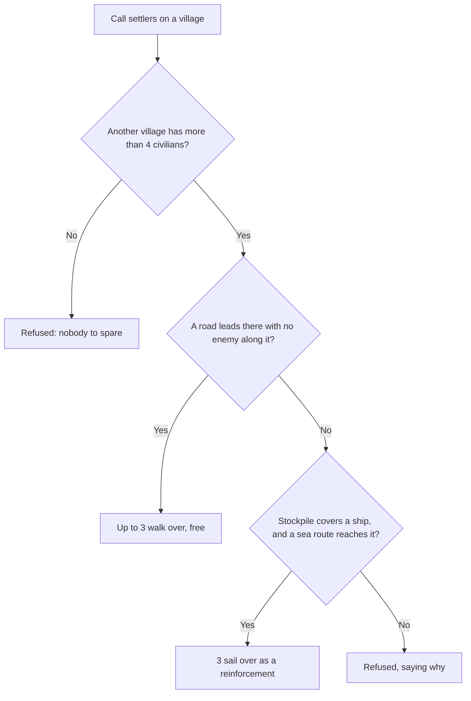

# Gameplay

Kingdom is a hands-off builder. You don't pilot a hero. You set priorities,
place build orders, and let your civilians and knights act on their own AI. Your
job is to grow a self-sustaining settlement and outlast the enemy camps sharing
your continent.

## Worlds and seeds

Everything starts at the main menu:

- **:lucide-globe: Create World:** enter a **seed** and generate a fresh world. A set seed
  is fully reproducible: the same seed always yields the same terrain, resources,
  and enemy placements. Leave the field blank (or press **:lucide-dices: Random**) to roll a
  random one. Text that isn't a number is hashed into a seed, so `"my castle"`
  is a valid seed too.
- **:lucide-folder-open: Load Saved World:** restore your last save (enabled only when one exists).
- **:lucide-play: Resume:** jump back into the session you left when you opened the menu.
- **:lucide-flask-conical: Testing Ground:** open an empty gray grid instead of
  a world, then click to place units of any faction and type, and paint water,
  trees, walls, and houses around them in an instant, to see how they behave.
  See **[Testing Ground](testing.md)**.

See **[The World](world.md)** for how a seed becomes terrain.

## Your starting position

You begin controlling **a single village** on the **coast** near the origin, a
small cluster of houses with a handful of **civilians** to work and **knights**
to defend. It sits right by the sea, giving your cargo ships a home port. That
village is the only settlement you own; everything grows outward from it.

Scattered across your home continent are several **enemy villages**, each with its
own units. They aren't idle: enemy soldiers stream out to hunt your units, so
you're on a clock from the start. And the map never settles: **fresh enemy and
allied villages keep being founded** farther and farther out as you play.

Enemy villages also **grow on their own**. A village left in peace raises new
houses over time, and each house supports more people, just like yours do. The
bigger the enemy's realm, the larger the total army it can field. Raid a camp
early and it stays small; ignore one and you'll face a stronghold later.

A town that has grown large and full goes further and **sends out a founding
party**: a few villagers and a knight walk out to plant a daughter village a
short way off, and the enemy's parties head **toward you**, so their border
creeps closer over time. The party is ordinary units on the road: catch it
before it arrives and the village is never founded.

## Factions

Three factions share the world:

- **You** (blue): the settlement you grow and command.
- **The enemy** (red): hostile to everyone. Their villages raid you *and* the
  allies, and you capture ground by clearing their villages of defenders. Once
  a village of theirs grows large, it **raids by sea** too, landing knights by
  your weakest coastal village with warships as escort (see
  **[The enemy navy](units.md#the-enemy-navy)**).
- **The allies** (green): a friendly faction on coasts **across the sea**. They
  are your **trade partners**: cargo ships sail to their shores to sell goods for
  gold, and now and then bring **[immigrants](#immigration)** home with them.
  Allied knights **attack the enemy** on their own, which quietly takes pressure
  off you, but they only join your battles when you
  **[hire them](#hiring-mercenaries)**, and they hire out
  **[warships](#hiring-an-escort)** too. You and the allies never fight.
  Allied units standing in one of your villages **hold it** against capture
  just as your own would. Allied villages can't be captured by anyone, so they
  make dependable, permanent trade destinations.

## The core loop

1. **Gather.** Civilians walk to the nearest reachable resource and chop wood or
   mine stone. Everything lands in your shared **stockpile**.
2. **Trade.** Load surplus wood and stone onto a [cargo ship](building.md#ship-goods)
   and launch it from your **harbor** to the nearest **allied coast** to sell for
   **:lucide-coins: gold** (stone sells for more). Flip the
   [autonomous-trade switch](building.md#autonomous-trade) and the harbor keeps
   dispatching laden ships on its own. Mind the open water, though:
   **pirates** prowl the ocean and will sink a cargo ship they catch (the alert
   it raises offers a one-click **Summon warship** when you can afford one).
3. **Build.** Spend wood, stone, and gold on [houses, bridges, mines, walls, and huts](building.md).
   A click places an order; a civilian drops its gathering at once to take up
   the **builder's** job, walks over, and puts the structure up over a few seconds (the builder's pay is part
   of the cost). Houses raise their own village's population cap and
   periodically spawn new workers, so each settlement grows on its own. Mark
   [builder zones](building.md#builder-zones) and flip the autonomous-building
   switch to let builders raise houses there without further clicks.
4. **Grow.** More houses mean more population, and so more civilians and knights.
   You start with some **seed gold**, but every new **knight** costs gold to arm. A
   broke village raises a (free) civilian instead, so keep the trade routes running.
5. **Defend & expand.** Keep knights around to fend off raids, then push into
   enemy territory and take their villages. When the frontier worth having lies
   across the sea, send a **[settler ship](#settling-overseas)** instead and
   found a village of your own on a far shore.

Use the **Priority** and **Gather** toggles in the HUD to steer this loop:
lean **Agriculture** while you're building up, swing to **Military** when a camp
starts pressing you.

!!! note "Soldiers need a workforce behind them"
    Your houses always raise **civilians** while they have room, however the
    Priority toggle is set, so a realm can never be stranded without the hands
    it needs. **Knights** are the part that needs an economy: while you have
    3 or fewer civilians, houses raise workers only, and growth runs at its
    slowest until the workforce recovers. The more civilians you have, the
    faster new villagers arrive.

Under **Military**, some of those soldiers come mounted: whenever you have
fewer than one horseman for every two knights and 50 gold to spare, the next
soldier a house raises is a **[horseman](units.md#horsemen)**, fast cavalry
that can leap the narrower streams. Likewise, whenever you have fewer than one
bowman for every two knights and 30 gold to spare (the cavalry comes first),
the next is a **[bowman](units.md#bowmen)**, who shoots foes from five tiles
away but is frail up close. And whenever you have fewer than one axeman for
every two knights and 35 gold to spare (after the cavalry and bowmen), the
next is an **[axeman](units.md#axemen)**: slow and tough, throwing axes as it
closes and winding up a spin that strikes everyone around it.

## Capturing villages

Territory changes hands per-village:

- **Taking an enemy village:** if an enemy village has *no defenders of its own
  left* but one of your units is standing inside it, that village converts to
  your control.
- **Losing one of yours:** the same rule applies in reverse. If a village of
  yours is left undefended with an enemy inside it, you lose it. When that
  happens, the knights **near the lost village** automatically rally to try to
  retake it, while garrisons farther away stay at their own posts.

This makes defense and offense the same skill: keep a presence in your villages,
and strip the enemy's before you move in.

### After the battle

A captured village converts whole: its **houses become yours** on the spot, and
the walls around it change hands with them. The army settles in right behind
the conquest: of the knights standing in the village when it falls, **some lay
down their arms and become civilians** so the place is worked rather than
merely occupied. How many depends on the ground:

- **Contested** (enemies still prowling nearby): **half** the knights settle
  and the rest stay under arms.
- **Quiet** (no enemy in the area, as when you walk into an **empty village**):
  **everyone but a single garrison** settles, so the village starts producing
  at once.

Levies never settle (they're owed their pay back home), a lone conqueror always
stays a knight, and an alert tells you when knights have settled a village.

The village's **people change hands too**. Most of the fallen side's civilians
caught near the village are **incorporated into the conqueror's realm** and get
to work for their new rulers; the rest scatter. Civilians **hiding in huts
escape notice** and keep their old loyalty, and soldiers never turn. This cuts
both ways: when you lose a village, the enemy presses your villagers into its
own realm, so a fallen village costs you hands as well as houses. An alert
tells you either way.

Once you hold several villages, the **[Realm panel](controls.md#the-realm-panel)**
lists each one with its defenders and flags any that are under attack or left
empty, and **[alerts](controls.md#alerts)** tell you when one is raided, lost, or
taken. Press <kbd>M</kbd> for the **[overview](controls.md#the-overview)** to see
the whole realm at once.

## Settling overseas

Walking and bridging only carry you so far: the ocean is too wide to span, so
land across the sea is out of a knight's reach. **Settler ships** are how the
kingdom crosses it.

Pick **Settler ship** in the HUD's **Colonies** section and **left-click a far
shore**. If the stockpile covers the cost (30 wood, 20 stone, 50 gold), the
spot is clear of every standing settlement (except your own, see
[reinforcing](#reinforcing-a-colony) below), and a sea route reaches it from
one of your harbors (a river winding down to the ocean counts), then **3
civilians board a ship** and set sail from whichever harbor connects best. At
least 4 civilians always stay home, so an expedition can't hollow out your
economy.

You'll know the order went through: a **blue banner is planted on the landing**
the moment the ship casts off and stays there until it arrives, an
**[alert](controls.md#alerts)** announces the departure (the ship launches from
your harbor, usually far from where you clicked), and the Colonies section
counts the **expeditions at sea**. A refused click answers too: a toast at the
spot says **why it couldn't go through**, whether the shore is too close to a
settlement, no sea route reaches it, there's no shore there at all, or the cost
or crew isn't covered.

When the ship drops anchor, the settlers go ashore, **raise the colony's first
two houses**, and get to work. The new village is yours in every way: it shows
up in the **[Realm panel](controls.md#the-realm-panel)**, its houses raise
population on their own, and its coast works as a harbor, so **cargo ships can
launch from the colony** too; a colony settled near allied shores makes for
short, safe trade runs.

A few things to mind:

- **Pirates sink settler ships** as readily as cargo ships, and the crew goes
  down with the hull. Escort a precious expedition with a
  [warship](building.md#warship-the-navy) or clear the lanes first.
- A fresh colony starts **undefended**. Knights spawn there like anywhere else
  once there's gold and population headroom, but until then an enemy wandering
  in can [take it](#capturing-villages), and a colony is far from any enemy
  that walks. The enemy's **[sea raids](units.md#the-enemy-navy)** go for your
  least-defended village, though, so an empty colony is exactly where a raid
  lands.
- Settling is for **new ground**: the landing must be well away from every
  existing enemy and allied village, and far enough from your own that the two
  wouldn't crowd each other. Landing **at** one of your own villages is the
  exception: that's a [reinforcement](#reinforcing-a-colony).

New villagers are **raised wherever homes stand emptiest**: of your villages
with room to grow, the least full one gets the next worker. A fresh colony of
three settlers fills up first instead of waiting its turn behind the capital.

### Reinforcing a colony

A young colony short on hands doesn't have to wait for homes to fill on their
own. Send a settler ship **at one of your own villages**, clicking its shore,
and instead of founding anew the settlers sail over, go ashore, and **join it**:
three more civilians, no new houses, and an alert when they land. The usual
costs, crew rules, and pirate risk apply. **:lucide-users: Call settlers** on
the colony's row in the Realm panel does the same thing for you when no road
clear of the enemy leads there, picking the harbor itself (see
[Moving people between villages](#moving-people-between-villages)).

See **[Building](building.md#settler-ship)** for the full launch rules.

## Moving people between villages

Civilians work the village they live in and never wander off to another on
their own. To send people where they're needed, such as a freshly captured
village or a frontier with building to do, press **:lucide-users: Call
settlers** on that village's row in the
**[Realm panel](controls.md#the-realm-panel)**.

- **Who comes:** the other village with the most civilians to spare sends up
  to **3**. Like a settler ship, it always keeps **4** at home, so a village
  of 5 sends just one and a village of 4 or fewer sends nobody. Of its people,
  the ones nearest the village that called answer first.
- **Over land, for free:** where a road joins the two villages and no enemy
  stands along it, the settlers walk it. It costs nothing but the time on the
  road. Once they arrive they get to work there, and from then on that's
  home.
- **Never through a war:** a road with an enemy soldier or an enemy village
  within 10 tiles of it doesn't count. The call goes to the next village with
  people to spare and a clear road, and failing that, to the sea.
- **By sea, where no clear road leads:** if nobody with people to spare can
  walk there safely (a colony across the water, or a road the enemy holds), a
  full crew of 3 sails over from the sending village's harbor as a
  [reinforcement](#reinforcing-a-colony) instead, at a settler ship's usual
  cost (30 wood, 20 stone, 50 gold) and with the usual pirate risk.
- **The road has its dangers:** settlers on the road are out in the open.
  When raiders come near they run for the nearest hut like any villager, and
  one who takes shelter on the way stays in that hut's village instead of
  finishing the trip. If the village that called them falls before they get
  there, they give up and settle in whichever village is nearest.

An alert tells you when settlers set out and another when the last of them
arrives, and the Realm panel counts how many are on the road. A refused call
costs nothing and says why: no other village has civilians to spare, no road
or sea route leads there, the enemy holds the road and no ship can go
instead, or a ship is needed and the stockpile doesn't cover it.

## Invading overseas

Colonies claim empty shores; **troop ships** take held ones. Pick **Troop
ship** in the HUD's **Navy** section and **left-click a far shore**, right by
an enemy village if you like: **4 of your standing knights board at the
harbor** (levies stay home) and go ashore at the banner, ready to fight. On
landing they **march on the nearest enemy village** within range on their own
(a self-lifting rally, which never overrides a flag you planted yourself), then
their ordinary instincts take over: they hunt the defenders, batter the huts
and walls, and the moment the village stands undefended with your knights
inside, it's [captured](#capturing-villages) and some of them
[settle it](#after-the-battle). Land at an **empty** village and all of that
happens the moment they walk in. Only a shore with no enemy village within
marching reach leaves the party waiting at the beach for your rally flag.

The same feedback applies as for settling: a banner on the landing, a departure
alert, a landing-parties count in the Navy section, and a toast explaining any
refused click. The same risk applies too: a troop ship is **unarmored**, and
pirates send it down knights and all, so shell the coast clear with
[warships](building.md#warship-the-navy) and escort the crossing. There's no
return trip; the landing force wins its new home or holds the beach.

See **[Building](building.md#troop-ship)** for the full launch rules.

## Hiring mercenaries

The allies hire out their knights. With a **rally flag** of your own planted,
the HUD's Rally section offers **Hire allied mercenaries** for 100 gold, paid up
front. The allied village nearest the flag that can spare a company (it always
keeps a garrison home) loads **4 knights** onto one of its ships, which sails for
the coast nearest your flag; a green-hulled ship and banner mark the crossing,
and the Rally section counts companies at sea and mercenaries ashore.

Ashore, the company **answers your flag** exactly as your own knights do, then
fights as allies always have: hunting the enemy, battering their huts and
walls, and holding ground. Mercenaries standing in one of your villages **hold
it** against capture. Once no flag stands and no enemy has come near them for
a while, their work is done and they **sail home**, with an alert to say so.

Two rules keep this a *joint* invasion rather than an outsourced one:

- **Only your own units capture a village.** Mercenaries soften a village's
  defenses, but it flips to you only when one of yours stands in it with no
  defender left.
- **The hull is as unarmored as any transport.** Pirates can sink the company
  you paid for, so clear the lanes or escort the crossing.

A refused hire costs nothing and says why: no flag of yours standing, too
little gold, no allied village with knights to spare, no beach near the flag,
or no sea route to it.

## Hiring an escort

The allies hire out their warships as well. The HUD's Navy section offers
**Hire allied escort** for 60 gold, paid up front. An allied warship, in the
allies' green hull, casts off from the **allied port nearest your home
harbor** and crosses to it, with an alert for the departure; from then on it
sails as one of **[your navy](units.md#the-navy)**: it hunts pirates and enemy
ships, shells enemies ashore, patrols the deep sea when idle, and **answers
your navy rally flag** just as your own warships do. The Navy section counts
escorts sailing with the fleet, and at most **two** are out at once.

Once no navy flag stands and no pirate or enemy has been in sight of any
escort for a while, their work is done and they **sail home**, with an alert
to say so. An escort still crossing over never turns back early. An escort
has a warship's armored hull, but pirate and enemy guns can still sink it,
and an alert tells you if one goes down.

A refused hire costs nothing and says why: too little gold, the escort cap
already afloat, no open water by your houses to cross to, or no sea route
joining an allied port to your harbor.

## Immigration

Trade with the allies is a trickle of people as well as gold. When a cargo ship
docks at an allied port, there's a fair chance **one or two allied families
take passage home with its crew** and settle in whichever of your villages has
the most empty homes, the same choice newly raised villagers make. They arrive
only while your population has room, so houses still set the ceiling, and an
alert marks each arrival. Keep the trade lanes busy and safe and the realm
fills faster; let pirates close them and the flow stops with the gold.

## Scoring

There's no hard win screen. It's a survival-and-expansion sandbox. The HUD
tracks two numbers that measure how you're doing:

- **Enemies defeated:** total enemy units you've killed (including any trapped
  and finished off).
- **Units lost:** your own casualties.

Grow your kingdom, wipe out the rival camps, and keep your losses low.
