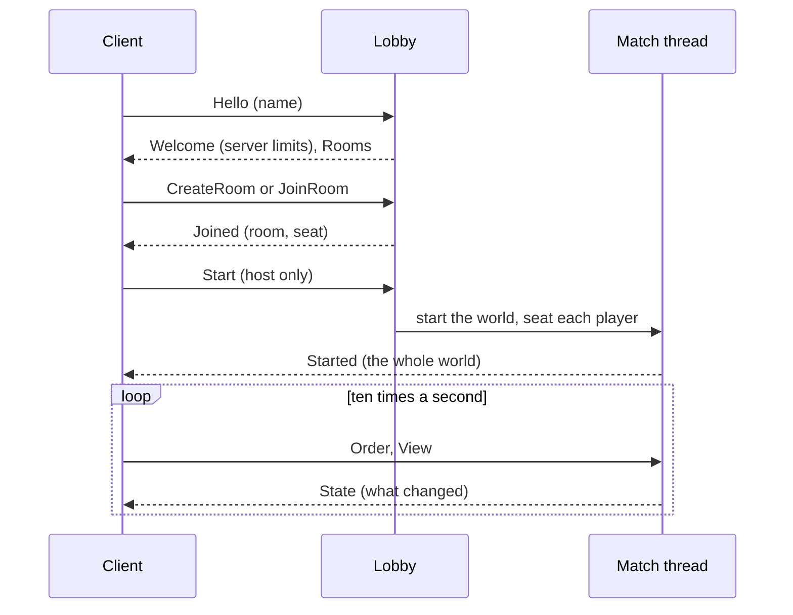
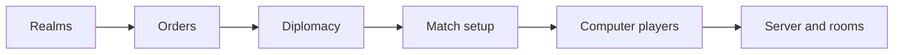

# Multiplayer

Kingdom has a multiplayer mode: several empires on one map, each run by a
person or by the computer, playing by the same rules the single-player game
uses. A match server hosts rooms; players connect from the main menu, open or
join a room, and play. This page covers how to host and join, how it works,
and what this first version doesn't do yet. Nothing here changes how a
single-player world plays.

## Hosting a server

### From the game

The native game can host a server itself. In the main menu's
**Multiplayer** section, pick a port (7777 unless you change it) and press
**Host**. The game starts a server in the background, connects you to it,
and shows the address to give the others, such as `192.168.1.20:7777`. From
there you open a room like anyone else. **Stop Hosting** shuts the server
down and ends every match on it, and so does quitting the game.

A server hosted this way uses the default limits from the table below. The
first time you host, your system may ask whether the game may accept
incoming connections; allow it, or nobody else can reach you. The web build
can't host, because a browser page can't listen for connections.

### On its own

The server is also its own program, `kingdom-server`, in the same
repository. It runs headless, so any machine on the network can host,
including one without a screen, and it can serve the web build. Build and
start it with:

```sh
trunk build --release                                # the web build, into dist/
cargo run -p kingdom-server --release -- --web dist  # listens on port 7777
```

`--web dist` is optional. With it, the server also hands out the web build,
so a friend on the same network can open `http://<your address>:7777/` in a
browser and play without installing anything. Leave it off if everyone plays
the native build.

| Option | What it does | Default |
| --- | --- | --- |
| `--bind <addr:port>` | Where to listen | `0.0.0.0:7777` |
| `--web <dir>` | Serve the web build in `<dir>` at `/` | off |
| `--max-rooms <n>` | Most rooms open at once | 8 |
| `--max-slots <n>` | Most seats a room may have | 8 |
| `--no-room-creation` | Players may not open rooms | rooms allowed |
| `--no-ai-diplomacy` | The computer's realms never ally | they may |
| `--no-join-in-progress` | Nobody joins a match already under way | they may |

The log says who opens, joins and leaves rooms, and when a match starts. Set
`RUST_LOG=debug` for more. Stop the server with Ctrl+C; matches are not
saved, so stopping it ends them.

## Joining a match

If you host from the game, you are already connected. Otherwise, the main
menu has a **Multiplayer** section. Type the server's address (the
port defaults to 7777, so `192.168.1.20` is enough), pick a name, and press
**Connect**. Nothing touches the network until you do.

Once connected you see the server's rooms. **Join** takes the first free
seat in one, or **Open Room** starts a room of your own with the number of
realms you want and whether the computer's realms may ally (within what the
server allows). The person who opens a room is its host; the room lists who
holds each seat, and the host presses **Start Match** when everyone is in.
Every seat nobody holds goes to the computer. If the host leaves before the
start, the next person in the room becomes host, and a room closes once
everyone has left it.

In the match, the HUD works as it does alone, except that there is no save
box: the server keeps the world. **Leave Match** (where the save box was)
returns you to the menu, and the computer takes your realm over until
someone sits in it again. Closing the game or losing the connection does the
same.

!!! note "Browsers and local networks"
    Browsers guard pages against reaching machines on your local network.
    Chrome asks permission before a page from the internet may connect to a
    local address, and a page loaded over `https` can only reach a server
    over secure WebSockets (`wss://`). The simplest way around both is to
    open the game from the server itself (`--web`), so the page and the
    server share one address. The hosted version of the game on GitHub Pages
    can only reach a server that has `wss://` set up in front of it.

## How a match runs

The server runs the world; clients draw it and send orders. A client never
steps the simulation itself, so there is nothing to keep in lockstep and no
way for two copies of the world to drift apart.



- **Rooms live in a lobby**, a plain state machine that answers every
  message from a client. Each running match gets its own thread, which owns
  the world and steps it twenty times a second, so one busy match never
  holds up the lobby or another match.
- **Orders are the same `Command`s the HUD gives alone.** The match applies
  each for the seat that sent it, exactly as single player applies a click.
- **Each client says where its camera looks.** The match runs everything in
  the union of those views at full rate and the rest of the map in slower
  batches, as single player does around its one camera.
- **Updates carry only what changed.** The world is sent in the save format.
  The first message holds every edited chunk; after that each update holds
  only the chunks edited since the last one, plus the units, fleets and
  realms whole and the moment's flags, alerts and missiles. Untouched
  terrain never travels: the client generates it from the seed, the same
  way the server did.

## Limits of this first version

- **Units move in steps.** Positions arrive ten times a second and the
  client draws them as they come, with no smoothing in between.
- **Bandwidth grows with the population.** Every update carries every unit
  and realm whole, so a large match on a slow link may lag. That is fine on
  a home network; it is the first thing to make leaner.
- **There are no accounts.** Anyone who can reach the server may join, and a
  player who drops out and comes back takes the first free seat, which
  might not be the realm they left.
- **Matches are not saved,** and nothing ends one: it runs until everyone
  has left its room.

## The design

- **Every empire is a realm.** A realm is an empire run on the player's
  rules: it gathers, builds, trades, recruits and hires exactly as you do. The
  world holds any number of them. The computer's rival camps (the enemy) and
  the trade-partner villages (the allies) stay what they are, non-realm
  factions with their own behavior.
- **A match has a fixed number of seats.** People take seats; the computer
  fills any seat nobody has taken, so a match with every seat taken has no
  computer-run empire at all. The computer plays by issuing the same orders a
  person would, which also means a seat whose player drops out keeps running
  until they come back. There is a practical cap on seats (`MAX_SLOTS`), but
  nothing is sized by it: raising the one constant is the whole change.
- **Players choose their alliances.** Realms start at war with one another.
  An alliance needs both sides to agree; leaving one takes effect after a
  short notice. Whether computer-run realms may make alliances is up to the
  server.
- **One server, many rooms.** A server hosts rooms. Anyone may create a room
  (if the server allows it) and others join it; each room is one match with
  its own settings, chosen by its creator within the limits the server
  operator sets: how many seats, whether the computer's realms may ally, and
  whether players may join a match already in progress.
- **The server runs the game.** Clients send orders and receive the state;
  the simulation runs in one place, so there is nothing to keep in lockstep.

## Where it stands

The work lands in stages, each of which keeps single-player working:



| Stage | What it does | Status |
| --- | --- | --- |
| **Realms** | Every per-player thing (stockpile, flags, switches, alerts, hired help) lives in a `Realm`, and the game holds a list of them. Houses, ships and orders carry their owner. | Done |
| **Orders** | Everything the HUD does is a `Command` the game applies for a given realm (`Game::apply`), so a remote player and the computer can give the same orders a local one does. The HUD only reads the game and hands orders back. | Done |
| **Diplomacy** | A relations table (`Diplomacy`) decides who fights whom. Realms start at war; `ProposeAlliance`, `AcceptAlliance`, `DeclineAlliance` and `LeaveAlliance` orders change that, with a one-minute notice before an alliance ends. The Realm panel shows and drives it. A computer-run realm answers a proposal at once, accepting when the match allows it. | Done |
| **Match setup** | `MatchSettings` (seats, whether the computer's realms may ally) and `Game::new_match`, which plants one capital per seat around a ring, well apart, with the first seat a person's and the rest the computer's. The main menu offers the setting. Each realm past the first gets a hue of its own, and the atlas recolors every team-colored sprite for it. | Done |
| **Computer players** | `bot::think` reads the game and returns the orders a computer-run realm gives, every few seconds: it switches on the builders and the harbor, zones its capital and opens new zones as they fill, balances gathering, raises people until a workforce stands and soldiers after that, calls the draft when attacked and unarmed, raises a hut, plants a rally flag on the nearest hostile village once it has a strike force to spare, and (when allowed) accepts offers and proposes alliance to whichever realm outgrows it. It keeps no state and touches nothing directly, so a seat passes between a person and the computer at any moment. | Done, a first cut |
| **Server and rooms** | The simulation moves into its own crate (`kingdom-core`) that the client and the new headless server (`kingdom-server`) share. The server hosts rooms over WebSockets, runs each match on its own thread and streams state as `Game::to_wire` updates; the client's menu connects, lists and opens rooms, and plays a match the server runs. See the sections above. | Done, a first cut |

## What this means for saves

A save now records every realm along with who owns each ship, construction
order and hired unit (format version 20), and the state of diplomacy between
them (version 21). Older saves describe one realm and load as one, at war
with nobody but the enemy; see **[Saves & Files](saves.md)**.

The server's updates reuse the version 21 format with one addition after the
diplomacy section: a tail of the moment's transient state (flags, alerts,
saplings, pirates and everything in flight). A save never has that tail, and
a saved world loads exactly as before. Matches played on a server are never
written to a save.
