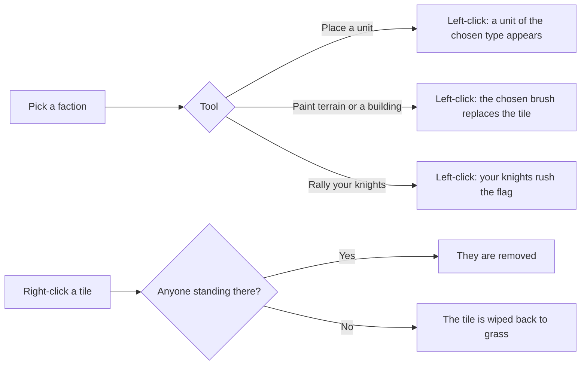

# Testing Ground

The **testing ground** is an empty, light gray grid with nobody on it. It is
for experimenting: put units of any faction and type down wherever you like,
paint water, trees, walls, and houses around them in an instant, and watch how
they behave, with no villages or economy getting in the way. It is meant for
testers and the curious, not for play, and it is **never saved**.

Open it with the **:lucide-flask-conical: Testing Ground** button on the main
menu. The camera opens on the origin at the usual zoom, and all the normal
[camera controls](controls.md#input) work, including the overview.

## What you get

- **A flat world.** Every chunk starts as bare, walkable ground drawn as a
  gray grid. There is no water, no forest, no ore, and no village anywhere,
  however far you pan, until you paint some in. Nothing grows and nothing
  spawns on its own: the realm-level clocks that raise villagers, found
  villages, send raids, and put pirates to sea all stay stopped.
- **Real units.** Anyone you place is an ordinary unit running the same AI it
  would in a real game. Enemy soldiers hunt your units and the allies',
  bowmen shoot from range, horsemen ride down the foot, and civilians putter
  about. Wounded units show their HP bars and the dead are removed as usual.
- **Instant terrain and buildings.** A brush paints water, trees, rocks,
  bridges, houses, walls, huts, and mines straight onto the grid: no builder,
  no cost, no placement rule. Painted structures are the real thing, so
  knights hack at an enemy wall, civilians hide in a hut, and a horseman
  leaps a painted stream.
- **One panel.** The *Testing Ground* window in the top-left replaces the
  usual HUD. It holds the faction and unit picker, the brush picker, the
  rally tool, a count of who is on the grid, and the kill and loss tallies.

## Placing, painting, and erasing

First choose a **faction**: *Yours*, *Enemy*, or *Allied*. It owns every unit,
house, wall, and hut you put down until you pick another. The tile under the
pointer is washed in that faction's color when what you're about to place
belongs to it, and in white when it belongs to no one.

Then pick a tool. Clicking any unit type or brush selects its tool too, so you
can switch by picking what you want to place.

### Units

Choose a **type**: *Civilian*, *Knight*, *Horseman*, or *Bowman* (see
**[Units & Combat](units.md)** for what each one does), then **left-click** a
tile to put one down. Click again to stack more on the same tile; once a
fight reaches them they spread out (see
**[Combat resolution](units.md#combat-resolution)**). A tile nobody could
stand on (a wall or water, say) refuses the click.

### Terrain and buildings

Choose a **brush** and **left-click** a tile. Painting first wipes the tile
back to bare grass and then puts the brush down, so a house painted over a tree
simply replaces it:

| Brush | What stands | Owner |
| ----- | ----------- | ----- |
| **Grass** | Bare, open ground: the eraser | |
| **Water** | Open water, a barrier to the foot | |
| **Tree** | A tree with a full load of wood | |
| **Rock** | A rock with a full load of stone | |
| **Bridge** | Water with a bridge over it, walkable | |
| **House** | A house in its faction's style | The chosen faction |
| **Wall** | A wall at full strength | The chosen faction |
| **Hut** | An empty hut at full strength | The chosen faction |
| **Mine** | A bottomless stone source | |

Painted houses cluster into villages like real ones, so an enemy standing in
an undefended village of yours still **captures** it (see
**[Capturing villages](gameplay.md#capturing-villages)**), but they raise no
villagers: place the people yourself. Once a house of yours stands, your
civilians go to work around it as they would at home, chopping, mining, and
sowing within the usual leash.

Anyone standing on a tile you paint over is left where they are and walks out
on their own.

### Erasing

- **Right-click** a tile to remove everyone standing on it. Removal is not a
  death, so it counts toward neither tally. If nobody is there, the tile is
  wiped back to bare grass instead.
- **:lucide-x: Clear everyone** takes every unit off the grid, arrows and
  rally flag included, and leaves the terrain.
- **:lucide-x: Clear the grid** wipes every painted tile back to grass and
  leaves the units.

### Rallying

Switch to **:lucide-flag: Rally your knights** and a left-click plants a
rally flag for your soldiers, exactly as the
**[rally mode](units.md#rallying-your-knights)** does in a real game: plant
as many as you like, your soldiers split up among them nearest first (an
under-manned flag drawing more), and each flag lifts once someone reaches it.
Clicking a flagged tile lifts that flag, and a **:lucide-x: Clear rally
flags** button appears while any stand. Right-click still erases units and
tiles in this tool, so use the button or a second click to lift a flag.

## What is different from a real game

- **No villages, so no retreat.** In a real game a faction that runs short of
  civilians pulls its knights back home to become workers. On the testing
  ground there is no home to fall back to, so soldiers always stay soldiers,
  however few civilians stand beside them. A badly outnumbered soldier can
  still break and run from a fight for a few seconds, just as in a real game.
- **Your civilians only work near a painted house.** With no house of yours
  on the grid, a civilian of yours just wanders and hides from danger like any
  other villager. Paint a house and they gather, mine, and sow around it as
  usual.
- **No stockpile or orders.** Everything is painted for free, so the build
  modes, trade, colonies, and navy are absent from the panel. What your
  civilians gather still lands in a stockpile, but nothing spends it.
- **Never saved.** The testing ground has no **Save** button, and it can't
  touch your save slot. **:lucide-menu: Menu** takes you back to the main
  menu, where **:lucide-play: Resume** returns to the grid as you left it
  until you create or load another world.
